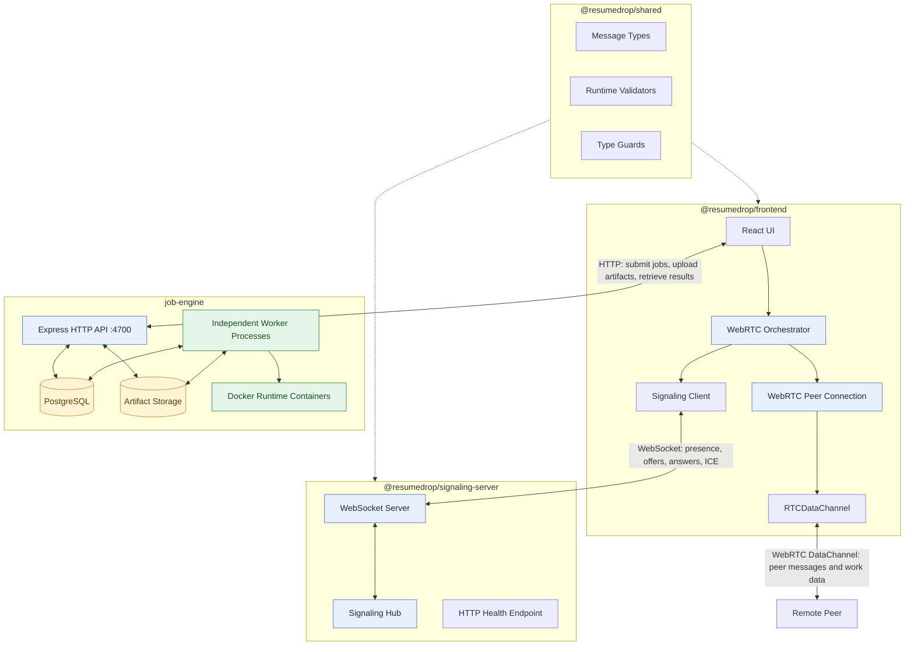

# ResumeDrop - Reliable WebRTC Foundation 

**ResumeDrop** is a P2P file transfer foundation that enables direct browser-to-browser communication using WebRTC, with a WebSocket signaling server for connection setup and coordination.

The project is structured as an **npm workspace** with four packages that share a common type definition package (`@resumedrop/shared`).

## Architecture Overview



### Package Structure

#### 1. `@resumedrop/shared` — Core Protocol Types

The shared package defines the wire protocol used by both the signaling server and browser clients. It includes:

- **Message types** (`MessageType` enum): Registration, discovery, WebRTC signaling (offer/answer/ICE), control messages
- **Message interfaces**: `CoordinatorRegisterMsg`, `WorkerRegisterMsg`, `WebrtcOfferMsg`, `WebrtcAnswerMsg`, `WebrtcIceCandidateMsg`, `ErrorMsg`, `DisconnectMsg`
- **Runtime validators**: `validateBaseMessage`, `validateRegistrationMsg`, `validateWebrtcOfferMsg`, etc.
- **Type guards**: `isCoordinatorRegisterMsg`, `isWebrtcOfferMsg`, etc.
- **Base fields**: `type`, `timestamp`, `clientId`

**Usage**: Imported by both the signaling server and the frontend.

```
shared/
  src/messages.ts    # Message type definitions and interfaces
  src/validators.ts  # Runtime validation functions
  src/index.ts       # Re-exports everything
```

#### 2. `@resumedrop/signaling-server` — WebSocket Signaling Hub

The signaling server is the central coordination point for WebRTC peer connections. It runs on Node.js and provides:

- **WebSocket endpoint** (`/ws`) for real-time message routing
- **SignalingHub** managing client registrations (coordinators and workers)
- **Worker discovery**: Coordinators can request the current list of registered workers
- **Targeted message routing**: WebRTC offers/answers/ICE candidates are routed point-to-point
- **Registration enforcement**: One active session per `clientId`; role-based access control
- **Health check**: `GET /health` endpoint

**Architecture**:
```
SignalingHub (in-memory map of clients)
  ├── Registered clients (by clientId)
  │   ├── Coordinators: can request worker discovery
  │   └── Workers: notify coordinators of availability
  └── Message routing:
      ├── Registration messages (COORDINATOR_REGISTER, WORKER_REGISTER)
      ├── Discovery requests/responses
      ├── WebRTC signaling (offer -> worker, answer -> coordinator)
      └── ICE candidates & disconnect messages
```

**Key Features**:
- In-process, in-memory hub (no external dependencies)
- Automatic coordinator notification when workers register/disconnect
- Validation of all inbound messages against shared protocol

```
signaling-server/
  src/signaling.ts   # SignalingHub class
  src/index.ts       # createServer() Express + WebSocket setup
  package.json       # Depends on @resumedrop/shared, express, ws
```

#### 3. `@resumedrop/frontend` — React Coordinator/Worker UI

The frontend is a React web application that provides the user interface for:

- **Role selection**: Coordinator or Worker
- **Connection management**: Connect/disconnect from signaling server
- **Worker discovery**: View registered workers (coordinators only)
- **Peer connection setup**: WebRTC offer/answer/ICE candidate exchange
- **Data channel messaging**: Send text messages between peers
- **Status monitoring**: Connection state, registration state, peer states

**Architecture**:
```
App (React component)
  └── useOrchestrator hook
        ├── SignalingClient (WebSocket transport)
        └── WebRTCOrchestrator (state machine binding transport + peer + UI state)
              └── Peer (RTCPeerConnection wrapper)
                    ├── offer/answer sequencing
                    ├── ICE candidate handling
                    └── data channel (label: "resumedrop")
```

**Key Pages/Components**:
- Role selection (coordinator/worker radio buttons)
- Connection status badges (WS open/registered)
- Worker list (coordinators only)
- Peer connection status (PC + DC state)
- Message sending/receiving history

```
frontend/
  src/App.tsx          # Main UI component
  src/hooks/useOrchestrator.tsx  # Orchestrator hook
  src/lib/             # transport, orchestrator, peer, clientId
  src/components       # StatusBadge, panels, etc.
  package.json         # Depends on @resumedrop/shared, react, react-dom
```

### How the P2P Flow Works

1. **Coordinator tab** loads and selects "coordinator" role, then connects to the signaling server
2. **Worker tabs** load and select "worker" role, then connect to the signaling server
3. **Coordinator** requests worker discovery → signaling server returns list of registered workers
4. **Coordinator** connects to a specific worker → WebRTC peer connection established
5. **Data channel** opened for file transfer or message exchange
6. **Direct P2P communication** — all media/data flows directly between browsers, bypassing the signaling server

### Execution Lifecycle:

1. **Upload an artifact** — `POST /artifacts` receives a ZIP file, validates size/entry count, stores it on the local filesystem, and persists metadata (id, filename, sha256, storage_key) in PostgreSQL.
2. **Submit a job** — `POST /jobs` with `type` and `payload`. For `execute_artifact`, the artifact must exist. Idempotency keys prevent duplicate submission. The job is persisted as `queued`.
3. **API validates and persists** — The job is validated, type-checked, and inserted with status `queued`. For `execute_artifact`, the ZIP is validated and extraction limits are applied.
4. **Workers atomically claim eligible jobs** — Workers call `claimNextJob()` which uses `SELECT ... FOR UPDATE SKIP LOCKED` to atomically pick the oldest eligible `queued` job, transition it to `running`, increment `attempt_count`, and set a lease with `lease_expires_at` and `lease_generation`.
5. **Docker executes the workload** — The worker extracts the ZIP to a temp directory, launches a Docker container with resource limits (CPU, memory, timeout, pids), runs the command, captures stdout/stderr, and stores the result.
6. **Results, logs, attempts, and status are persisted** — On success, `markSucceeded` writes `exit_code`, `stdout`, `stderr`, and sets status to `succeeded`. On failure, `markFailed` writes the structured error and schedules retry if attempts remain.

**Job Leases, Heartbeats, and Fencing:**

- Every claimed job gets a `lease_expires_at` timestamp (default 30s). If the worker does not renew the lease before expiry, the job becomes eligible for re-claiming.
- `renewLease()` is fenced against `lease_generation` — a renewal that sees a changed generation aborts, preventing split-brain scenarios.
- Heartbeats run on a separate interval and also renew the lease. If heartbeats fail or the lease safety deadline is reached, the job is marked as `ownership_lost` and the worker stops processing it.

## Key Features (Implemented)

- **ZIP artifact ingestion and validation** — `POST /artifacts` with multer size limits; validates compressed byte limit, entry count, and total/uncompressed byte limits.
- **PostgreSQL-backed job queue** — Durable job storage with full lifecycle tracking (status, leases, attempts, heartbeats).
- **Atomic job claiming and concurrent workers** — `FOR UPDATE SKIP LOCKED` ensures only one worker claims a given job; multiple workers coordinate purely through the database.
- **Docker-based execution** — Containers launched with `--rm --network none --read-only --tmpfs`, CPU/memory/pids limits, `--pids-limit`, `--security-opt no-new-privileges`, and `--cap-drop ALL`.
- **Job leases, heartbeats, and fencing** — Lease-based liveness protection with generation-fenced renewal; heartbeat failure leads to `ownership_lost` and job re-claiming.
- **Retry and failure handling** — Configurable retry policy with exponential backoff (`initialDelayMs * multiplier^exponent`, capped at `maxDelayMs`). Failed jobs with remaining attempts are re-queued with a `next_attempt_at` timestamp.
- **Job cancellation** — `POST /jobs/:id/cancel` requests cancellation via `requestCancellation`; the owning worker can fencedly complete it via `markCancelled`. Queued jobs transition directly to `cancelled`; running jobs have `cancellation_requested_at` set.
- **Idempotent job submission** — `idempotency_key` + `fingerprint` (canonical stringify of type+payload+maxAttempts) prevents duplicate job creation via unique constraint on `idempotency_keys.key`.
- **Job status, result, and log retrieval** — `GET /jobs/:id` returns full job state; `GET /jobs/:id/result` returns result/exitCode for terminal states; `GET /jobs/:id/logs` returns `stdout`/`stderr`.
- **Worker registration and fleet health APIs** — `GET /workers` and `GET /workers/:id` return derived health status (`online`/`stale`/`stopped`) from `last_heartbeat_at` and `shutdown_at` timestamps.

## Tech Stack

- **Runtime**: Node.js (ESM), Node 20+
- **Web Framework**: Express
- **Database**: PostgreSQL via `pg` pool
- **Docker**: `python:3.12` image for workload execution
- **ZIP Processing**: Custom extraction with resource limits
- **Testing**: Vitest (unit), Playwright (e2e)
- **Configuration**: Environment variables (`.env` / `.env.example`)
- **Runtime Limits**: CPU, memory, timeout, command length, JSON input size, input depth, output bytes

## Getting Started

### Prerequisites

- Node.js 20+
- PostgreSQL 16+
- Docker (for executing `execute_artifact` jobs)

### Environment Configuration

1. Copy `.env` from `.env.example`:
   ```bash
   cp .env.example .env
   ```
2. Set required environment variables in `.env`:
   - `DB_USER` — database user (default: `jobeng` from docker-compose)
   - `DB_PASSWORD` — database password (default: `jobeng-secret`)
   - `DB_HOST` — database host (default: `127.0.0.1`)
   - `DB_NAME` — database name (default: `job_engine`)
   - `PORT` — API port (default: `4700`)
   - `WORKER_ID` — worker identifier (optional; random UUID if unset)
   - `ARTIFACT_STORAGE_DIR` — directory for ZIP artifacts (default: `./data/artifacts`)

### Dependency Installation

```bash
npm install
```

### Database Setup and Migrations

```bash
# Start PostgreSQL (docker compose up -d from the job-engine directory)
docker compose up -d

# Apply migrations
npm run migrate
```

### Starting the API

```bash
npm run dev:job-engine
```

The API listens on `0.0.0.0:4700` and responds at these endpoints:

- `GET /health` — process liveness + database readiness
- `GET /` — `{ name: "job-engine", version: "0.1.0" }`
- `POST /jobs` — submit a new job
- `GET /jobs/:id` — retrieve job status and metadata
- `GET /jobs/:id/result` — retrieve result/exitCode (terminal states only)
- `GET /jobs/:id/logs` — retrieve stdout/stderr
- `POST /jobs/:id/cancel` — request job cancellation
- `POST /artifacts` — upload a ZIP artifact
- `GET /artifacts/:id` — download artifact metadata
- `GET /workers` — list all workers with health status
- `GET /workers/:id` — retrieve one worker's health status

### Starting Workers

```bash
# From the job-engine directory
npm run worker
```

The worker process:

1. Loads configuration from environment (`WORKER_ID`, `WORKER_POLL_INTERVAL_MS`, `WORKER_CONCURRENCY`)
2. Runs pending migrations
3. Registers the `python:3.12` DockerRuntime
4. Spins up the Worker process with configurable concurrency
5. Each slot independently calls `claimNextJob()` using `FOR UPDATE SKIP LOCKED`
6. Claims are dispatched to the appropriate handler (currently `execute_artifact`)
7. Graceful shutdown on SIGINT/SIGTERM

## API Overview

| Method | Endpoint | Purpose |
|---|---|---|
| `GET` | `/health` | Process liveness + database readiness |
| `GET` | `/` | Root endpoint, `{ name: "job-engine", version: "0.1.0" }` |
| `POST` | `/jobs` | Submit a new job (body: `{ type, payload, maxAttempts? }`) |
| `GET` | `/jobs/:id` | Retrieve job status and metadata |
| `GET` | `/jobs/:id/result` | Retrieve result/exitCode (available for terminal states) |
| `GET` | `/jobs/:id/logs` | Retrieve stdout/stderr logs |
| `POST` | `/jobs/:id/cancel` | Request job cancellation |
| `POST` | `/artifacts` | Upload a ZIP artifact (multipart/form-data, `file`) |
| `GET` | `/artifacts/:id` | Retrieve artifact metadata |
| `GET` | `/workers` | List all workers with derived health status |
| `GET` | `/workers/:id` | Retrieve one worker's health status |

### Representative Request/Response

**Submit Job:**

```http
POST /jobs
Content-Type: application/json

{
  "type": "execute_artifact",
  "payload": {
    "artifactId": "0134abcd-...",
    "runtime": "python:3.12",
    "command": ["python", "script.py"],
    "resources": {
      "cpu": 0.5,
      "memoryMb": 512,
      "timeoutSeconds": 60
    }
  }
}
```

```http
HTTP/1.1 201
{
  "id": "550e8400-e29b-41d4-a716-446655440000",
  "type": "execute_artifact",
  "status": "queued",
  "payload": { ... },
  "result": null,
  "error": null,
  "createdAt": "2024-01-15T20:45:30.000Z",
  "updatedAt": "2024-01-15T20:45:30.000Z",
  "startedAt": null,
  "completedAt": null,
  "exitCode": null,
  "attemptCount": 0,
  "maxAttempts": 3,
  "nextAttemptAt": null,
  "cancellationRequestedAt": null,
  "stdout": null,
  "stderr": null
}
```

**List Workers:**

```http
GET /workers
```

```http
HTTP/1.1 200
[
  {
    "id": "f47ac10b-58cc-4372-a567-0e02b2c3d479",
    "type": "node",
    "startedAt": "2024-01-15T20:00:00.000Z",
    "lastHeartbeatAt": "2024-01-15T20:45:28.000Z",
    "shutdownAt": null,
    "status": "online"
  }
]
```

## Execution Semantics and Limitations

- **At-least-once execution semantics** — A job claimed by a worker may be re-claimed by another worker if the original worker's lease expires without renewal. The `lease_generation` fencing mechanism prevents two workers from simultaneously executing the same job, but in the event of worker failure (crash, network partition), the same job may be executed by a second worker, producing duplicate side effects. Applications must ensure their command handlers are idempotent or have compensating actions.

- **Lease fencing protects database state, not arbitrary external side effects** — The generation-based fencing in `renewLease()` and the `FOR UPDATE SKIP LOCKED` locking protect the PostgreSQL job row from concurrent writes. They do not prevent external side effects (e.g., file writes, API calls) from being duplicated if a job is re-claimed by another worker after a lease expiry.

- **Artifact storage is local** — ZIP artifacts are stored on the local filesystem under `ARTIFACT_STORAGE_DIR` (default: `./data/artifacts`). The `LocalArtifactStorage` class validates keys to prevent path traversal. This means horizontal scaling requires a shared filesystem (e.g., NFS, S3) or each worker node has a local copy.

- **Runtime and security limitations** — Docker containers use resource limits (CPU, memory, pids, timeout) but do not provide complete multi-tenant isolation. The `--read-only` filesystem and `--cap-drop ALL` reduce the attack surface, but a privileged container escape is possible if the Docker daemon is misconfigured. Timeout is best-effort — a job exceeding `maxTimeoutSeconds` will receive exit code 124 (timeout) but may not be instantly killed. The `python:3.12` base image is used; custom runtimes must be registered in the `RuntimeRegistry`.

- **No exactly-once execution guaranteed** — The system provides at-least-once semantics via lease-based claiming. Exactly-once deduplication is supported for *submission* (idempotency keys) but not for *execution* — if a job is re-executed after lease expiry, the same command runs again.

- **No automatic horizontal scaling** — Workers are separate processes that must be started and managed independently. The system does not autoscale based on queue depth or lease expiry events.

## Testing

### Unit Tests

```bash
npm run test:job-engine
```

Runs pure domain logic tests (state transitions, payload validation, request validation, error mapping) with no database required. Located in `src/__tests__/`.

### Integration Tests

```bash
npm run test:job-engine:integration
```

Uses a real PostgreSQL database (see `docker-compose.yml`). Runs the full HTTP -> service -> repository -> PostgreSQL -> worker -> PostgreSQL -> HTTP flow.

**External requirements for integration tests:**

- PostgreSQL must be running (via `docker compose up -d` in the job-engine directory)
- Docker must be available for `execute_artifact` job types

### E2E Tests

```bash
npm run test:e2e
```

Runs end-to-end tests via Playwright. Requires a running database and Docker.

### Test Database Setup

Integration and E2E tests use a dedicated test pool. See `test/helpers.ts` for `createTestPool()` and `truncateJobs()` which reset the `jobs` and `idempotency_keys` tables between test runs.

## Migration Commands

| Command | Description |
|---|---|
| `npm run migrate` | Apply pending migrations from the `migrations/` directory |
| `npm run migrate:job-engine` | Alias for `npm run migrate` (defined in root package.json) |

Migrations are applied on API startup and worker startup via `runMigrations()` in `src/db/migrate.ts`.

